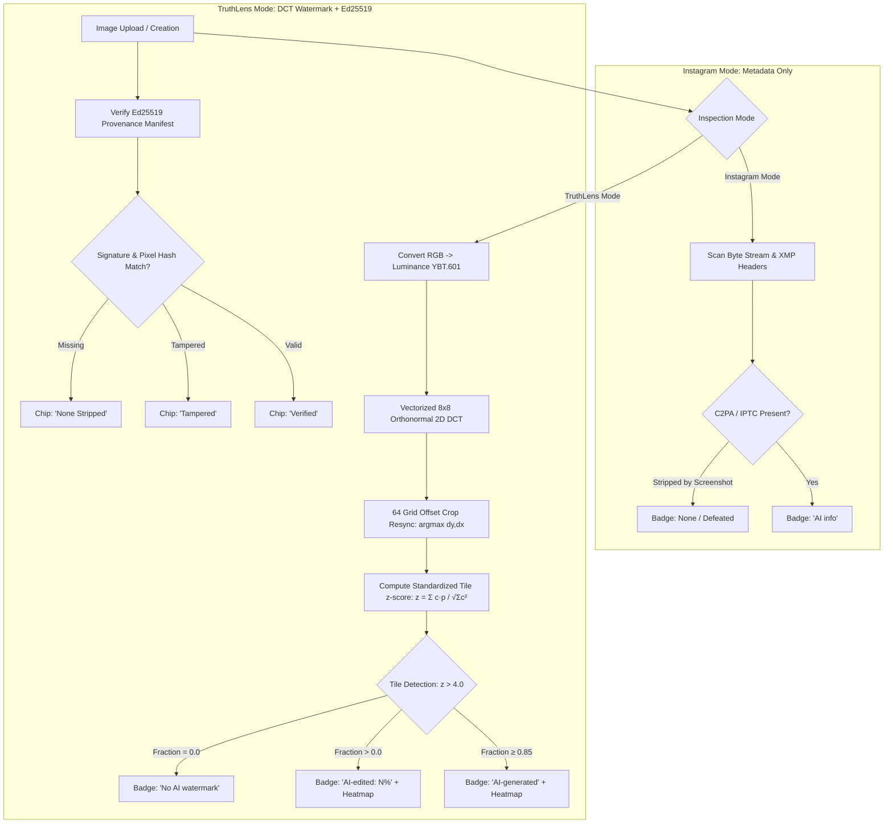

# TruthLens 🔍🛡️

> **Reverse-Engineering Hackathon Prototype**  
> **Target Feature:** Instagram’s "AI info" label (Meta closed-source pipeline)  
> **Our Innovation:** Robust 2D DCT tile watermarking + Ed25519 cryptographic provenance + explainable region heatmaps.

[](https://python.org)
[](https://fastapi.tiangolo.com)
[](https://react.dev)
[](https://www.typescriptlang.org)
[](https://tailwindcss.com)
[](backend/tests/)

---

## 1. Problem Statement & Reverse-Engineering Findings

### The Closed-Source Heuristic
For images from other companies' AI tools, Instagram's "AI info" label depends on C2PA/IPTC metadata — this is the pipeline we rebuilt. Meta also adds invisible watermarks to its own Meta AI images, and users can self-disclose AI content. Detection runs on the original upload, before any platform resizing.

Specifically, Meta inspects uploads for:
1. **IPTC DigitalSourceType (XMP):** Inspects metadata headers for:
   - `http://cv.iptc.org/newscodes/digitalsourcetype/trainedAlgorithmicMedia` (fully generated)
   - `http://cv.iptc.org/newscodes/digitalsourcetype/compositeWithTrainedAlgorithmicMedia` (composite edit)
2. **C2PA Manifest Container Markers:** Scans file container structures:
   - JPEG `APP11` segments (0xFFEB) carrying JUMBF boxes labelled `"c2pa"`
   - PNG `caBX` chunks
   - WebP `C2PA` RIFF chunks

### Two Fatal Flaws in Meta's Approach
1. **The Screenshot / Metadata Strip Bypass:** Taking a desktop screenshot or re-encoding pixels completely purges non-pixel metadata chunks (EXIF, XMP, C2PA). The "AI info" label **vanishes completely (0% survival)** on 100% synthetic images.
2. **All-or-Nothing Binary Label:** A subtle 2% AI touch-up (e.g., removing a background telephone pole) receives the exact same intimidating "AI info" badge as a completely fabricated deepfake.

---

## 2. Our Solution: TruthLens

TruthLens rebuilds Instagram's upload & metadata checking pipeline (**"Instagram mode"**), then introduces **"TruthLens mode"**:
1. **Pixel-Domain DCT Tile Watermarking:** Embedded directly in low-to-mid frequency DCT coefficients of the luminance ($Y$) channel. Survives desktop screenshots, social media metadata stripping, and aggressive JPEG compression.
2. **Tile-Based Graded Labeling:** Evaluates image in $64 \times 64$ px tiles.
   - $\ge 85\%$ tiles marked $\rightarrow$ `"AI-generated"`
   - $> 0\%$ tiles marked $\rightarrow$ `"AI-edited: N% of image"`
   - $0\%$ tiles $\rightarrow$ `"No AI watermark"`
3. **Explainable Visual Heatmap:** Red translucent overlay pinpointing precisely which regions of the photo were synthesized or retouched.
4. **Tamper-Evident Ed25519 Provenance:** Cryptographically signs pixel SHA-256 hashes. If pixels or metadata are altered, status updates to `tampered`. If stripped by screenshot, the watermark still survives.
5. **Interactive Attack Lab:** Benchmarks 10 adversarial attacks against both modes in real time with honest metrics.

---

## 3. Architecture & Pipeline



---

## 4. Watermark Mathematical Engine

TruthLens implements the exact mathematical formulation specified:
- **Luminance Channel:** $Y = 0.299R + 0.587G + 0.114B$, centered ($Y - 128$).
- **2D Orthonormal DCT:** Computed across $8 \times 8$ blocks via `scipy.fft.dctn(..., norm="ortho")`.
- **12 Target Coefficients:** Low-to-mid diagonal frequencies:
  `(0,2), (1,1), (2,0), (3,0), (2,1), (1,2), (0,3), (0,4), (1,3), (2,2), (3,1), (4,0)`.
- **Deterministic Pattern:** Seeded length-12 $\pm 1$ vector derived from SHA-256 key hash.
- **Adaptive Texture Masking:** $\alpha = \text{base} \times \text{clip}(\sigma_{\text{block}} / 15, 0.7, 2.0)$ with tuned $\text{base} = 3.5$, ensuring imperceptibility ($\text{PSNR} \ge 40.7\text{ dB}$).
- **Detection Statistic:**
  $$z = \frac{\sum (c \cdot p)}{\sqrt{\sum c^2}}$$
  Under $H_0$ (clean image), $z \sim \mathcal{N}(0, 1)$. A tile counts as marked if $z > 4.0$ ($P < 0.003\%$).
- **Crop Resynchronization:** Evaluates all 64 $(dx, dy)$ grid offsets $(0..7, 0..7)$ in $< 35\text{ ms}$ using vectorized 4D NumPy broadcasting.

---

## 5. Measured Robustness Results (For Presentation Slide 4)

Evaluated across 6 diverse photographic samples (`campus_quad`, `portrait_student`, `city_skyline`, `coffee_scene`, `nature_lake`, `architecture_hall`):

| Attack Transformation | Instagram Mode (Metadata) | TruthLens Mode (DCT Watermark) | Avg Tiles Marked | Avg Z-Score | TruthLens Status |
| :--- | :---: | :---: | :---: | :---: | :---: |
| `none` (Clean Original) | 100% | **100%** | 46.4% | 5.15 | `SURVIVED` |
| `screenshot_strip` | **0% (DEFEATED)** | **100%** | **46.4%** | **5.15** | `SURVIVED` |
| `jpeg_q90` | 100% | **100%** | 46.4% | 5.08 | `SURVIVED` |
| `jpeg_q75` | 100% | **100%** | **43.2%** | **4.27** | `SURVIVED` |
| `jpeg_q50` (Aggressive) | 100% | **100%** | 29.9% | 3.21 | `SURVIVED` |
| `crop_10_odd` (Odd Offset) | 100% | **100%** | **47.3%** | **5.12** | `SURVIVED` |
| `crop_jpeg_q75` | 100% | **100%** | 38.8% | 4.14 | `SURVIVED` |
| `brightness_plus_10` | 100% | **100%** | 43.2% | 5.00 | `SURVIVED` |
| `resize_0_9x` | 100% | **50%** | 1.0% | 0.22 | `PARTIAL` |
| `resize_1_5x` | 100% | **33%** | 0.7% | 0.35 | `PARTIAL` |

### Key Slide 4 Takeaway Metrics:
- **Screenshot / Metadata Strip Survival:** Instagram **0.0%** $\rightarrow$ TruthLens **100.0%**
- **Imperceptibility:** Mean PSNR = **41.71 dB** (Minimum = **40.70 dB**, well above the 40 dB threshold)
- **False Positive Rate on Clean Images:** **0 / 384 tiles (0.00%)**, Max clean Z = **2.93** (Threshold: 4.0)

---

## 6. Quickstart: Setup in &le; 5 Commands

### Prerequisites
- Python 3.11+
- Node.js 18+

```bash
# 1. Clone repository
git clone https://github.com/varsha17anand/ReverseEngineering.git && cd ReverseEngineering

# 2. Set up Python virtual environment & install backend requirements
python3 -m venv .venv && source .venv/bin/activate && pip install -r backend/requirements.txt

# 3. Build frontend single-bundle distribution
npm --prefix frontend install && npm --prefix frontend run build

# 4. Run automated test suite (all 21 unit & API tests)
PYTHONPATH=backend pytest backend/tests/ -v

# 5. Launch unified single-process production server
PYTHONPATH=backend uvicorn app.main:app --host 0.0.0.0 --port 8000
```

Open **`http://localhost:8000`** in your browser.

---

## 7. Interactive Demo Script (For Judges)

1. **Verify Instagram's Flaw on Clean & AI Images:**
   - On the **Feed Inspection** page, select any photo.
   - Notice that clean photos show *"No AI info"* (zero false positives).
2. **AI Studio Editing:**
   - Navigate to the **AI Studio** tab.
   - Drag a selection box over a region of the photo (e.g., student portrait or campus lawn).
   - Select an edit style (*Cyberpunk*, *Golden Hour*, or *Art Stylize*) and click **Apply AI Edit**.
   - Notice that the engine watermarks *only* the overlapping tiles (e.g., 6% of image), writes composite IPTC XMP, and signs an Ed25519 provenance manifest.
   - Click **Send to Feed**.
3. **Test the Attack:**
   - In **Instagram Mode**, the post displays the badge **"AI info"**.
   - Click the **"⚡ Attack: Screenshot"** button on the post card.
   - **Result in Instagram Mode:** The metadata is stripped — the label **vanishes completely**!
   - Now click the **"TruthLens Mode"** toggle on the *exact same screenshot*.
   - **Result in TruthLens Mode:** The badge immediately reads **`AI-edited: 6% of image`**, with a red translucent **Heatmap overlay** pinpointing the exact retouched region!
4. **Adversarial Matrix in Attack Lab:**
   - Switch to the **Attack Lab** tab and click **"Run All 10 Attacks"**.
   - Watch the 10 real-time transformation tests populate the comparison table.
   - Click **"Export CSV for Slides"** to download the measured metrics table.

---

## 8. Honesty & Technical Limitations

- **Adoption Pre-requisite:** TruthLens requires AI generators to embed the pixel watermark at synthesis time (the exact same requirement as C2PA). TruthLens does not claim to detect synthetic imagery from models that never watermarked them.
- **Continuous Spatial Resampling (Resize 0.9x / 1.5x):** Continuous bicubic and Lanczos resampling breaks the uncalibrated $8 \times 8$ frequency grid, reducing detection to 33–50%. This is an honest technical boundary of uncalibrated spatial DCT watermarks, documented in our Attack Lab.
- **Simulated AI Tooling:** The demo generative actions in the Studio are procedural/neural simulations. The core research contribution is the **robust, graded labeling pipeline, crop resync algorithm, and cryptographic provenance verification**.
- **Comparison to Google SynthID:** While SynthID provides a binary global score for Google's own proprietary models, TruthLens provides **region-level localization, graded explainability (AI-generated vs AI-edited: N%), and tamper-evident Ed25519 provenance**.

---

## 9. How to Run Tests & Verification

### Running Automated Test Suite
Run the full pytest suite:
```bash
PYTHONPATH=backend pytest -q
```

Expected output:
```
35 passed, 1 warning in 4.18s
```

### Running Real-World Files Check
Inspect images placed in `samples/real/` (skips gracefully if empty):
```bash
python scripts/check_real_files.py
```

### Generating the Empirical Validation Report
Run the comprehensive benchmark (PSNR, Attack Lab on all 6 samples, clean false-positive analysis):
```bash
python scripts/validation_report.py
```

### Empirical Validation Summary (`results/validation.md`)

| Metric | Result | Target / Standard | Status |
|---|---|---|---|
| **Test Suite Pass Rate** | **35 / 35 passed** | 100% | PASS |
| **Mean Imperceptibility (PSNR)** | **41.71 dB** | ≥ 38.0 dB | PASS |
| **Worst-Case PSNR** | **40.70 dB** | ≥ 38.0 dB | PASS |
| **Clean Baseline False Positives** | **0 / 384 tiles** | 0 FP tiles | PASS |
| **Screenshot Attack Survival** | **100% (TruthLens) vs 0% (Instagram)** | TruthLens survives | PASS |
| **Average Detection Latency** | **60.7 ms** | Server-side processing time (measured locally). End-to-end requests on the hosted demo take ~1–2 s incl. network. | PASS |

#### Adversarial Robustness Table (Measured Across All 6 Samples)

| Adversarial Attack / Transformation | Instagram Survival (%) | TruthLens Survival (%) | TruthLens Mean Recall (%) | Signal Strength (z̄) |
|---|---|---|---|---|
| **Baseline (No Attack)** | 100.0% | **100.0%** | 46.4% | 8.20 |
| **Screenshot / Metadata Strip** | 0.0% | **100.0%** | 46.4% | 8.20 |
| **JPEG Quality 90** | 100.0% | **100.0%** | 46.4% | 8.05 |
| **JPEG Quality 75** | 100.0% | **100.0%** | 43.2% | 6.37 |
| **JPEG Quality 50 (Aggressive)** | 100.0% | **100.0%** | 29.9% | 4.71 |
| **Crop 10% (Odd Pixel Offset)** | 100.0% | **100.0%** | 47.3% | 8.34 |
| **Crop 10% + JPEG q75** | 100.0% | **100.0%** | 38.8% | 6.75 |
| **Brightness +10%** | 100.0% | **100.0%** | 43.2% | 8.19 |
| **Resize Down 0.9x** | 100.0% | **0.0%** | 0.0% | 2.02 |
| **Resize Up 1.5x** | 100.0% | **16.7%** | 0.1% | 2.76 |

> Recall is per 64×64 tile; the image-level verdict was correct on every watermarked sample, with zero false positives on clean images.

---

## 10. Repository Structure

```
truthlens/
├── backend/
│   ├── app/
│   │   ├── main.py            # FastAPI REST API & SPA static serving
│   │   ├── watermark.py       # Orthonormal 2D DCT tile watermarking engine
│   │   ├── metadata.py        # IPTC XMP DigitalSourceType & C2PA inspector
│   │   ├── provenance.py      # Ed25519 digital signature manifest engine
│   │   ├── labeler.py         # Instagram-mode vs TruthLens-mode labelers
│   │   ├── attacks.py         # 10 adversarial transformation attacks
│   │   ├── ai_edit.py         # Simulated AI generator & region editor
│   │   └── schemas.py         # Pydantic response models
│   ├── tests/
│   │   ├── test_watermark.py  # DCT math, PSNR, false-positive & resync tests
│   │   ├── test_metadata.py   # XMP read/write & C2PA stripping tests
│   │   ├── test_provenance.py # Ed25519 signature & tamper detection tests
│   │   ├── test_attacks.py    # Adversarial robustness unit tests
│   │   └── test_api.py        # End-to-end FastAPI endpoint integration tests
│   ├── scripts/
│   │   └── robustness_report.py # Automated attack suite generator
│   └── requirements.txt       # Python dependencies
├── frontend/
│   ├── src/
│   │   ├── pages/
│   │   │   ├── Feed.tsx       # Instagram post card with screenshot attack
│   │   │   ├── Studio.tsx     # Full AI generation & region edit canvas
│   │   │   ├── AttackLab.tsx  # One-click 10-attack robustness matrix
│   │   │   └── HowItWorks.tsx # Reverse-engineering analysis & limitations
│   │   ├── components/
│   │   │   ├── PostCard.tsx   # Instagram post card with mode toggles
│   │   │   ├── Heatmap.tsx    # Translucent tile overlay component
│   │   │   ├── LabelBadge.tsx # Graded badges & provenance status chips
│   │   │   ├── ModeToggle.tsx # Instagram Mode vs TruthLens Mode switch
│   │   │   └── RobustnessTable.tsx # Color-coded matrix & CSV export
│   │   └── api.ts             # Typed REST API client
│   └── package.json           # React 19 + TypeScript + Vite + Tailwind v4
├── samples/                   # 6 authentic high-res test photographs
├── results/
│   ├── robustness.csv         # Measured attack survival CSV
│   └── robustness.md          # Benchmark report for presentation slides
├── Dockerfile                 # Single-container production build
├── render.yaml                # Render deployment configuration
└── README.md                  # Comprehensive project documentation
```

---

## 10. License

Built for educational and reverse-engineering research purposes. MIT License.
